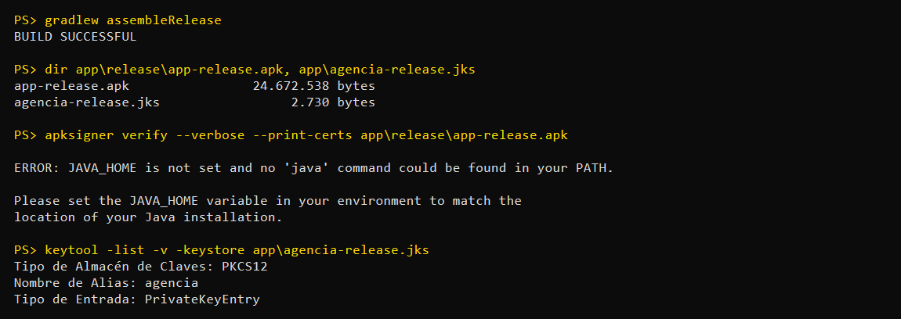

# Agencia de Oportunidades

App móvil para una agencia que gestiona oportunidades comerciales y activaciones corporativas (ferias, jornadas de beneficios, eventos en empresas). El ejecutivo registra la oportunidad, el supervisor la revisa y la confirma, y el equipo de activaciones coordina el evento y registra el resultado.

Asignatura: DSY1105 Desarrollo de Aplicaciones Móviles, Duoc UC.

## Integrantes

- José Ignacio Zúñiga
- Marco Leufuman

## Repositorios y planificación

- App Android: https://github.com/JoseIgnacio10/Agencia_oportunidades_APP_DATOS_MOVILES
- Microservicio de eventos: https://github.com/MarcoLeufuman/eventos-service
- Trello: https://trello.com/b/lLzRvwK7

## Funcionalidades

**Login y perfiles** (Room, tabla `usuarios`)
- Ejecutivo comercial: crea, edita y elimina oportunidades, registra el contacto y las gestiones.
- Supervisor comercial: revisa las oportunidades, cambia el estado (Pendiente, En gestión, Confirmada, Descartada), registra gestiones y administra el catálogo de eventos.
- Gestión de activaciones: ve solo las oportunidades confirmadas, programa la activación, la marca como realizada y registra el resultado.

**Oportunidades** (Room)
- Formulario con validaciones, fecha con formato automático, organización desde una lista y datos del contacto.
- Foto de evidencia con la cámara (CameraX) y carga de datos desde un código QR (ML Kit).
- Lista con búsqueda y pantalla de detalle con contacto, seguimiento de gestiones, activación y resultado.

**Catálogo de eventos** (microservicio propio)
- Listar, crear, editar y eliminar eventos desde la app. Los datos se guardan en MongoDB Atlas a través del microservicio en Spring Boot.

**Feriados de Chile** (API externa)
- Muestra los feriados del año actual desde la API pública Nager.Date.

## Base de datos local (Room)

Tablas: `usuarios`, `oportunidades`, `organizaciones`, `contactos`, `gestiones`, `activaciones`, `resultados`. La base está en la versión 5 y tiene migraciones de la 1 a la 5, así que al actualizar la app no se pierden los datos.

## Endpoints utilizados

**Microservicio propio** `eventos-service` (Spring Boot + MongoDB Atlas). Desde el emulador se llama con `http://10.0.2.2:8080`.

| Método | Endpoint | Uso en la app |
|---|---|---|
| GET | `/api/eventos` | Lista del catálogo |
| GET | `/api/eventos/{id}` | Buscar un evento |
| POST | `/api/eventos` | Crear evento |
| PUT | `/api/eventos/{id}` | Editar evento |
| DELETE | `/api/eventos/{id}` | Eliminar evento |

**API externa** Nager.Date (sin API key)

| Método | Endpoint | Uso en la app |
|---|---|---|
| GET | `https://date.nager.at/api/v3/PublicHolidays/{anio}/CL` | Pantalla de feriados |

Las dos se consumen con Retrofit (`remote/RetrofitInstance.kt`), cada una con su propia interfaz: `ApiService` para el microservicio y `FeriadoService` para la API externa.

## Estructura del proyecto

```
app/src/main/java/com/example/agenciasoportunidades/
├── MainActivity.kt
├── model/                 UiState, errores y modelos de la API
│   └── data/local/        Room: AppDatabase, entidades y DAO
├── remote/                Retrofit: ApiService, FeriadoService, RetrofitInstance
├── repository/            EventoRepository, FeriadoRepository
├── viewmodel/             Login, Oportunidad, Evento y Feriado
├── navigation/            AppNavigation
└── ui/
    ├── screens/           Pantallas en Compose
    └── theme/
```

Arquitectura MVVM: la pantalla observa el `StateFlow` del ViewModel, el ViewModel llama al repositorio (Retrofit) o al DAO (Room).

## Pasos para ejecutar

1. Levantar el microservicio (ver el README de `eventos-service`). Tiene que quedar corriendo en el puerto 8080.
2. Clonar este repositorio y abrirlo en Android Studio.
3. Sincronizar Gradle y ejecutar la app en un emulador (el emulador y el microservicio deben estar en el mismo PC).
4. Ingresar con alguno de los usuarios de prueba:

| Perfil | Correo | Clave |
|---|---|---|
| Ejecutivo comercial | ejecutivo@agenciaficticia.cl | Agencia2026 |
| Supervisor comercial | supervisor@agenciaficticia.cl | Agencia2026 |
| Gestión de activaciones | activaciones@agenciaficticia.cl | Agencia2026 |

Para probar el flujo completo: crear una oportunidad con el ejecutivo, confirmarla con el supervisor y después entrar con activaciones.

## Pruebas unitarias

Hechas con Kotest, MockK y JUnit, siguiendo el ejemplo de la guía `apirest0111-tests`. Se simula el repositorio con MockK para no depender de internet ni del microservicio.

| Archivo | Carpeta | Qué prueba |
|---|---|---|
| `EventoViewModelTest` | `src/test` | Carga de eventos desde el repositorio y validación del formulario vacío |
| `FeriadoViewModelTest` | `src/test` | Carga de feriados y mensaje de error cuando falla la API |
| `EventosScreenTest` | `src/androidTest` | La pantalla muestra el título, los eventos y el botón del supervisor |
| `FeriadosScreenTest` | `src/androidTest` | La pantalla muestra el feriado y su fecha |

Comandos:

```
gradlew testDebugUnitTest
gradlew connectedDebugAndroidTest
```

El segundo necesita el emulador abierto.

## APK firmado y llave

- APK: `app/release/app-release.apk`
- Llave: `app/agencia-release.jks` (alias `agencia`)
- Configuración: bloque `signingConfigs` en `app/build.gradle.kts`

Para generarlo de nuevo:

```
gradlew assembleRelease
```

El APK queda en `app/build/outputs/apk/release/`.

Verificación de la firma:


